Results for the realistic-sensor version of the simulator (gyro + star tracker +
lidar). Figures from the earlier idealized (magical) full-state sensor are archived in
`magical_sensor`.

### 1. Closed-Loop Docking (Nominal)
The 6-DOF closed loop successfully performs autonomous lunar-orbit rendezvous
and docking. From an initial 100 m relative offset with 10° attitude error,
the LQR controller drives relative position to the docking setpoint
([0, −5, 0] m, Hill frame) and attitude to alignment, with commanded thrust
decaying to zero at steady state, confirming convergence.
p.s. unaffected by the sensor/filter changes
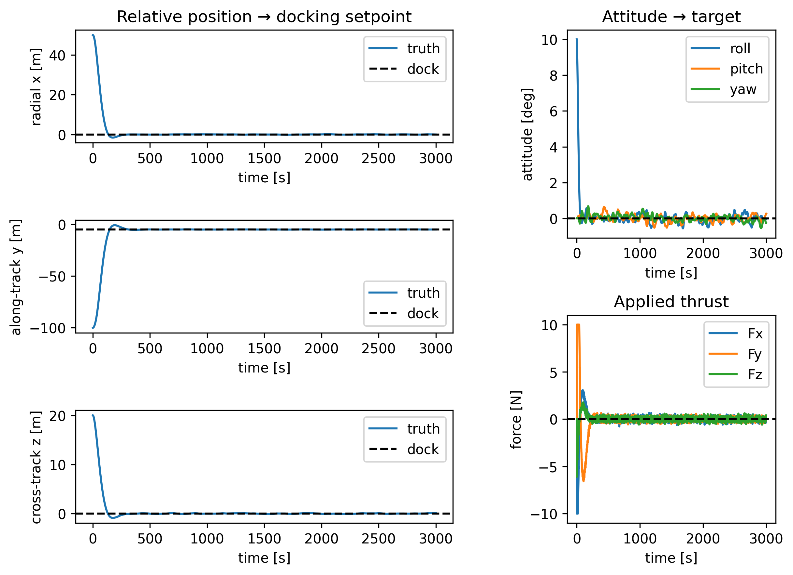

### 2. LQR Tuning
The LQR control-weight matrix R was swept across two orders of magnitude to
characterize the convergence-vs-propellant tradeoff. Low R yields aggressive
maneuvers that saturate thrusters and consume more propellant; high R conserves
propellant at the cost of slower convergence. R = 10 was selected as the
operating point.
p.s. unaffected by the sensor/filter changes
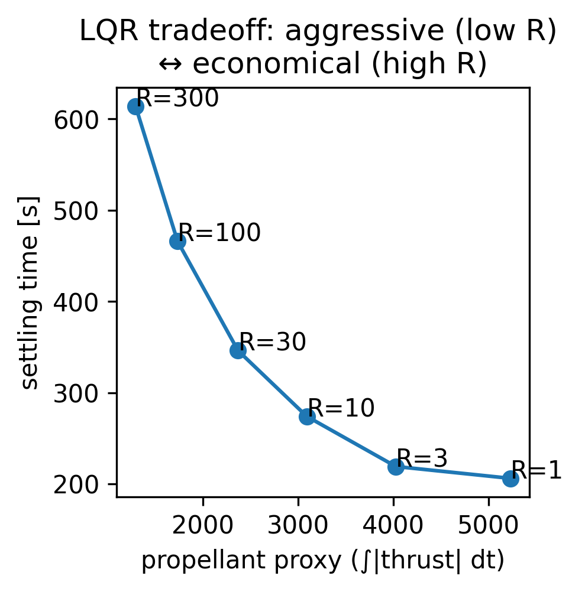

### 3. Sensor Suite and MEKF Navigation
The synthetic sensor was replaced with three sensors, and the filter was restructured around them:

| Sensor | Measures | Rate | Noise (1σ, arbitrary placeholder values) |
|---|---|---|---|
| Gyro | angular rate + bias | every step | ARW 0.5 °/√hr, bias random walk 0.5°/hr/√hr, turn-on bias 10 °/hr |
| Star tracker | attitude quaternion | 1 Hz | 2″ cross-boresight, 10″ about boresight |
| Lidar | range, azimuth, elevation (body frame) | 1 Hz | 0.1 m, 0.1° |

I plan to reaplce noise values with vendor datasheet numbers.

- **Gyro as a predict input.** Attitude is propagated with the bias-corrected gyro
  (ω_hat = ω_m − b_hat) instead of Euler's equation, so the filter no longer needs inertia/torque knowledge. The gyro just drives predictiont and has no innovation. Gyro bias is an estimated state.
- **Error state (12):** [δr, δv, δθ, Δb]. Attitude errors are a 3-parameter
  small-angle vector injected multiplicatively into the quaternion.
- **Sequential updates:** star tracker (H = [0 0 I 0]), then lidar (nonlinear
  range/bearing model; Jacobian includes the attitude coupling).

Steady-state estimation error (last 40% of a nominal run, single seed, translation
process-noise scale 1e-3):

| Channel | RMS |
|---|---|
| Position | 0.031 m |
| Velocity | 0.0023 m/s |
| Attitude | 0.003° (~11″) |
| Gyro bias | 0.45 °/hr |

Attitude error is about the raw star tracker noise (~10″): the filter does not beat
the sensor on attitude because the gyro's angle random walk per 1 s step (~30″)
exceeds the star tracker noise, so the filter correctly leans on the star tracker.
Gyro bias converges toward truth over the run; convergence speed is set by the gyro
ARW (bias error shrinks roughly as σ_step/√T).
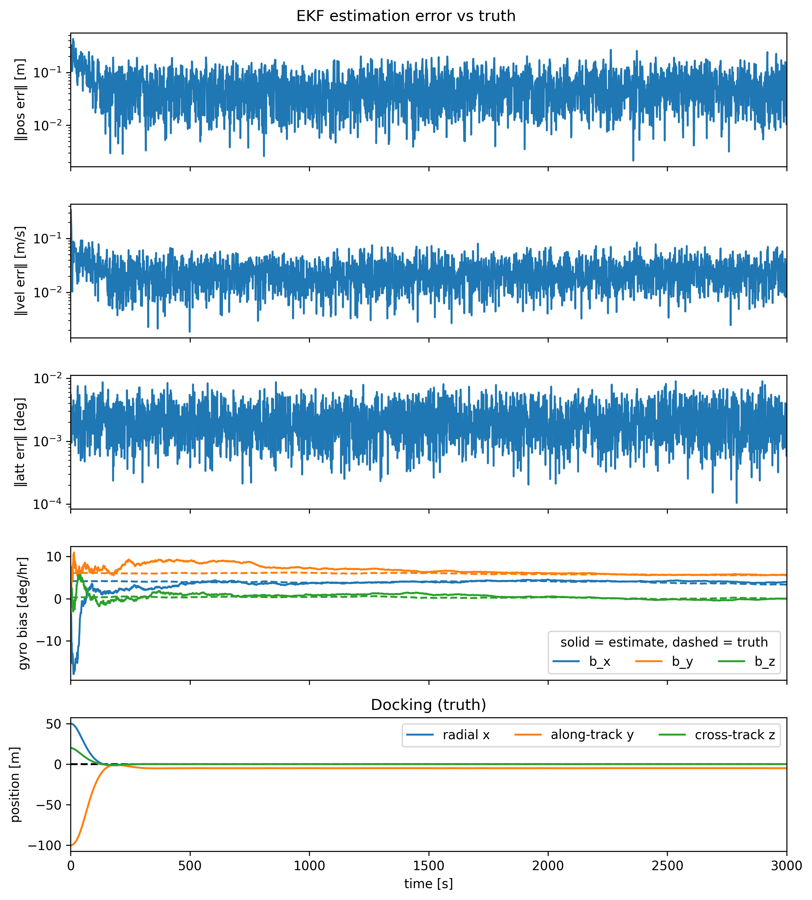

### 4. EKF Tuning
Only the position/velocity blocks of the process noise Q were swept; the attitude and bias blocks come from the gyro noise parameters and are left alone.

| Translation Q scale | Pos RMS [m] | Vel RMS [m/s] | Att RMS [deg] | Bias RMS [deg/hr] |
|---|---|---|---|---|
| 1e-4 | 0.023 | 0.0010 | 0.003 | 0.45 |
| 1e-3 | 0.031 | 0.0023 | 0.003 | 0.45 |
| 1e-2 | 0.041 | 0.0055 | 0.003 | 0.45 |
| 1e-1 | 0.055 | 0.0130 | 0.003 | 0.45 |
| 1 | 0.070 | 0.0281 | 0.003 | 0.45 |
| 10 | 0.085 | 0.0570 | 0.003 | 0.45 |

Position and velocity error fall monotonically as Q shrinks. This could be
explained by the simulation having no unmodeled translational dynamics, so the best
Q is zero and the sweep cannot identify an optimum.
The translation block of Q is therefore kept as a deliberate margin (scale 1e-3) 
against unmodeled thruster/environment effects, not a fitted value.
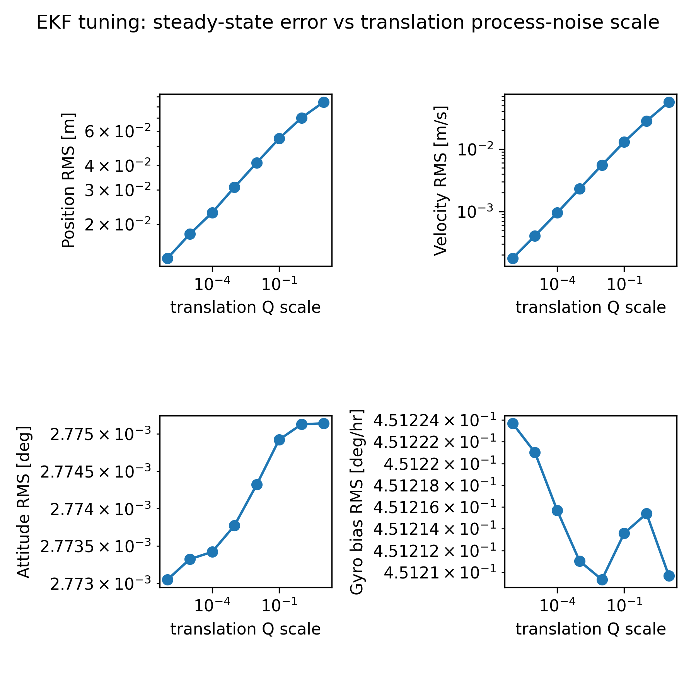

### 5. Filter Consistency (NEES / NIS)
Consistency was checked against chi-squared bounds, averaged over 30 independent
seeds at each timestep. Expected values: NEES 12 total and 3 per 3-dof block;
NIS 3 per sensor.

| Metric (expected) | Nominal truth (no process noise) | Matched process noise |
|---|---|---|
| NEES (12) | 9.14 | 12.15 |
| NIS star tracker (3) | 3.01 | 3.01 |
| NIS lidar (3) | 2.72 | 3.00 |
| NEES position (3) | 2.37 | 2.96 |
| NEES velocity (3) | 0.73 | 3.00 |
| NEES attitude (3) | 2.98 | 2.98 |
| NEES gyro bias (3) | 3.17 | 3.17 |

- **Matched process noise.** The truth is given random position/velocity
  disturbances with exactly the covariance the filter assumes (Q·dt). Every block
  lands at its expected value, which validates the covariance propagation, both
  measurement Jacobians, R, and the gyro/bias model.
- **Nominal truth.** NEES falls below its expected value, entirely from the
  position and velocity blocks: Attitude, bias, and the star-tracker innovations
  are calibrated; the lidar innovation is slightly conservative. 
  P.S. As for velocity, the simulation has no translational disturbances, and the margin only matters if something unmodeled happens. In the matched-noise run the plant has that noise, and those blocks go back to ~3, so we're good.
- Single-seed caution. A single run showed the bias block at 0.49 (expected 3);
  averaged over 30 seeds it is 3.17

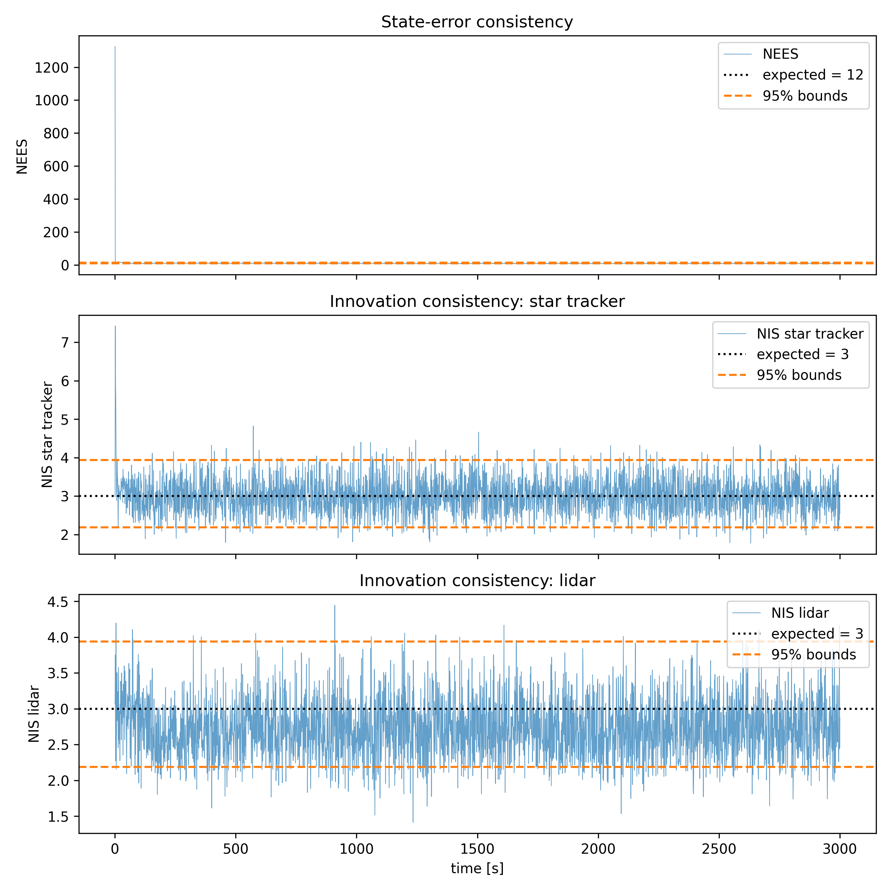
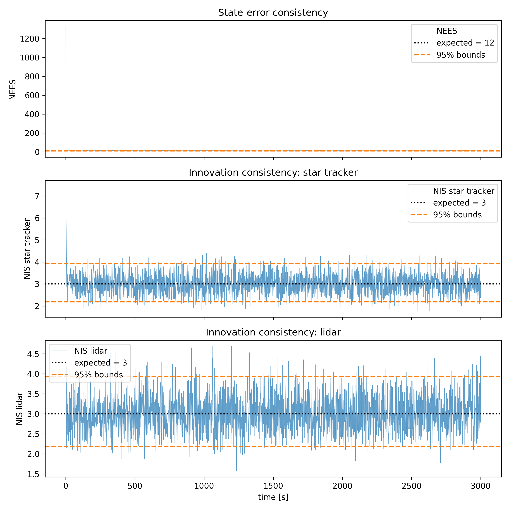

### 6. Verification Notes: Timing Alignment
Early plots showed a smooth bump in position (~1.2 m) and attitude (~0.27°)
error during the approach. The bump was largest when the vehicle moved fastest,
and its size matched speed × dt. A one-step lag puts the estimate one step behind.
That proportionality is why it pointed to timing and not to noise. I found that the filter was propagated to t_{k+1} before fusing a measurement taken at t_k, and the runner logged the estimate beside truth from the next step. The fix was to skip predicton the first call (so the filter state sits at the measurement time on every update) and to log estimates at the time they refer to. The bump disappeared.

### 7. Monte Carlo Robustness
A 50-run Monte Carlo applied dispersed initial conditions (±50 m position,
±2 m/s velocity, ±30° attitude, ±1°/s rate) with independent sensor noise seeds
(each run also draws its own true gyro bias).

- Convergence: every run docks successfully. Final position error averaged
  0.013 m (95th percentile 0.027 m, max 0.039 m); final attitude error averaged
  0.049° (95th percentile 0.083°, max 0.096°). All runs are well inside the
  1 m / 5° range.
- **Propellant-constrained:** scored against a 5000-unit propellant budget,
  success is **44.0%**. Propellant use averaged 6466 (max 18777), and per-run peak
  thruster saturation averaged 9.1% (max 30.8%). Since every run meets the
  position/attitude criteria, every failure is propellant exhaustion, not estimation error.

Comparison with the earlier idealized-sensor study (same seeds, dispersions and
budget; archived in `magical_sensor/`):

| | Idealized sensor | Realistic sensors |
|---|---|---|
| Success within budget | 24.0% | 44.0% |
| Propellant, mean (max) | 7309 (19447) | 6466 (18777) |
| Final position error, mean | 0.095 m | 0.013 m |
| Final attitude error, mean | 0.354° | 0.049° |

Final accuracy improves because the lidar and star tracker are probably more
precise near the dock than the idealized sensor. Note that the sensor noise
values are placeholders, so the comparison shows sensitivity to the sensor suite,
not a general result.
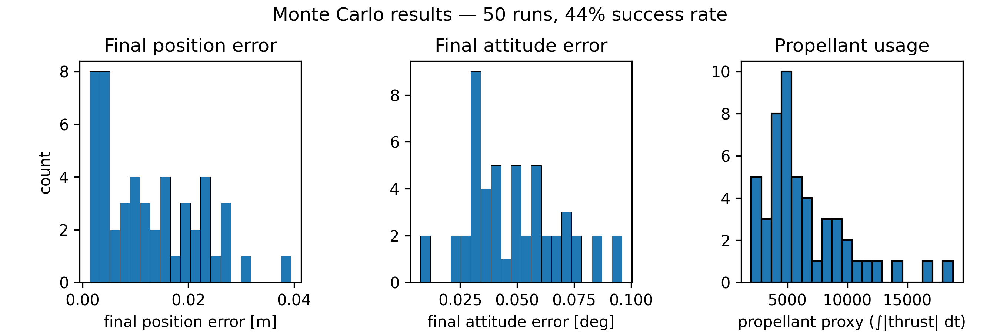

### 8. Robustness Envelope
A 16×16 grid over initial position offset (0–150 m) and initial along-track
velocity offset (0–5 m/s) was mapped against the 5000-unit propellant budget,
yielding an overall recoverable fraction of **73.4%** (188 of 256 cells).
Propellant use ranged from 1836 to 9259 across the grid.

- **Success is governed almost entirely by initial velocity offset.** At every
  position offset in the tested range (up to 150 m), all velocity offsets up to
  3.67 m/s succeed; no position offset succeeds at 4.00 m/s or above.
- Weak position dependence: The maximum recoverable velocity is 3.33 m/s for
  position offsets up to 30 m and 3.67 m/s from 40 m out, reflecting the coupled
  position-velocity dynamics of Clohessy-Wiltshire.

Comparison with the idealized-sensor study (archived in `magical_sensor/`):

| | Idealized sensor | Realistic sensors |
|---|---|---|
| Overall recoverable fraction | 64.5% | 73.4% |
| Velocity threshold (all positions) | 3.00 m/s | 3.67 m/s |
| Propellant range | 2751 – 10020 | 1836 – 9259 |

Again, the sensor noise values are placeholders, so this is not a general result.

### 9. Off-Nominal: Sensor Dropout
Outages were applied to the star tracker and lidar, together and one at a time (the gyro always stays on because it drives predict). Uncertainty grows until measurements return. Success means final position error < 1 m and attitude error < 5°. Recovery
time Rt = 3000 s − (outage end) is the time left after measurements return.

**Scenario A:** fixed start (t = 30 s, roughly during the approach), varying duration
Tabulated are final position & attitude errors.

| Duration | Rt | Both out | Lidar only out | Star tracker only out |
|---|---|---|---|---|
| 300 s | 2670 s | 0.009 m / 0.056° | 0.009 m / 0.056° | 0.010 m / 0.056° |
| 1000 s | 1970 s | 0.002 m / 0.056° | 0.002 m / 0.056° | 0.010 m / 0.056° |
| 2000 s | 970 s | 0.028 m / 0.055° | 0.028 m / 0.056° | 0.010 m / 0.056° |
| 2500 s | 470 s | 0.016 m / 0.055° | 0.016 m / 0.056° | 0.010 m / 0.055° |
| 3000 s (whole run) | none | 79.6 m / 16.4° **(fail)** | 79.6 m / 0.056° **(fail)** | 1.19 m / 13.6° **(fail)** |

**Scenario B:** fixed 2000 s duration, varying start

| Start | Rt | Both out | Lidar only out | Star tracker only out |
|---|---|---|---|---|
| 500 s | 500 s | 0.028 m / 0.056° | 0.028 m / 0.056° | 0.010 m / 0.056° |
| 750 s | 250 s | 0.153 m / 0.055° | 0.151 m / 0.056° | 0.010 m / 0.055° |
| 900 s | 100 s | 0.491 m / 0.043° | 0.490 m / 0.056° | 0.014 m / 0.040° |
| 950 s | 50 s | 12.6 m / 0.197° **(fail)** | 12.5 m / 0.056° **(fail)** | 0.036 m / 0.202° |
| 1000 s | 0 s | 3.29 m / 1.58° **(fail)** | 3.27 m / 0.056° **(fail)** | 0.068 m / 1.65° |

- Duration alone does not cause failure; **recovery time** does. Outages up to
  2500 s recover when measurements return with time to spare (similar to the old, magical sensor version).
- **Attitude is less sensitive to outages than position.** At the worst case
  (Rt = 0), losing the star tracker gives 1.65° (within 5°), while losing the lidar
  fails the 1 m criterion. This is probably because the gyro carries attitude through
  an outage, whereas nothing else carries position. This holds only if the outage
  starts after the gyro bias has been estimated.
- **Position drift scales with the velocity error at outage start.** The same
  lidar-out failure is 79.6 m when the outage starts at t = 30 s (velocity not yet
  converged) but 3.3 m when it starts at t = 1000 s.
- **Attitude errors feed back into position.** With the star tracker out for the
  whole run, attitude drifts to 13.6° (the star tracker was lost at t = 30 s, before
  the filter had estimated the gyro bias). Because the lidar measures in the body frame, that attitude error corrupts the position estimate: 1.19 m, close to range × attitude error (5 m × 0.24 rad).

Caveat: single seed. Position coasts well through outages because the filter's CW model and commanded force match the plant exactly. Real thruster or environment errors would degrade the coast, so the translation results are optimistic.

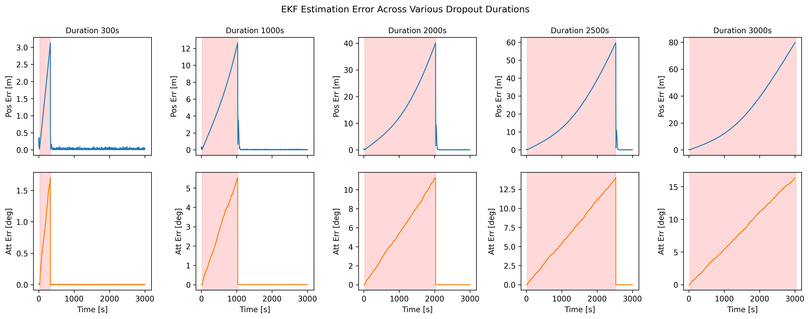
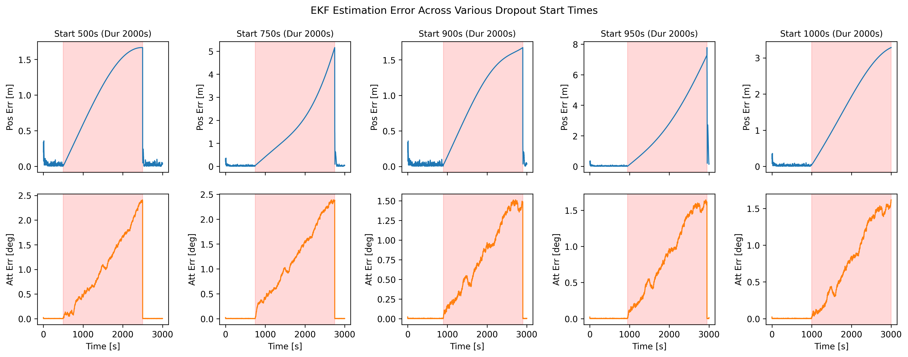
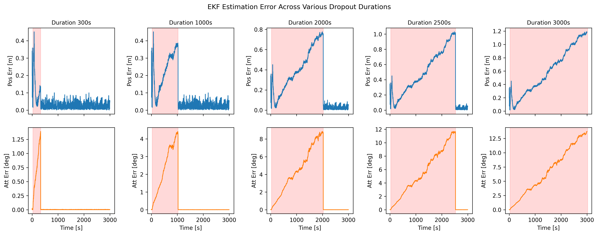
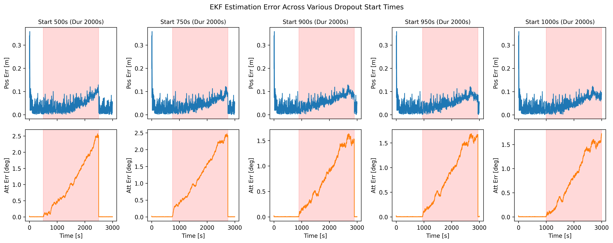
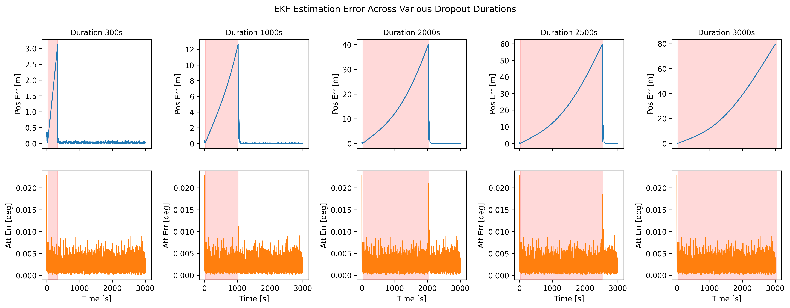
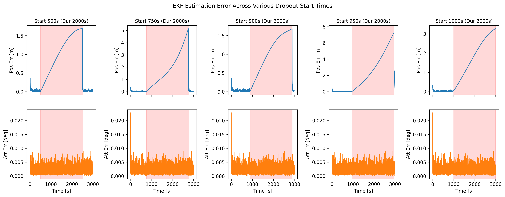
